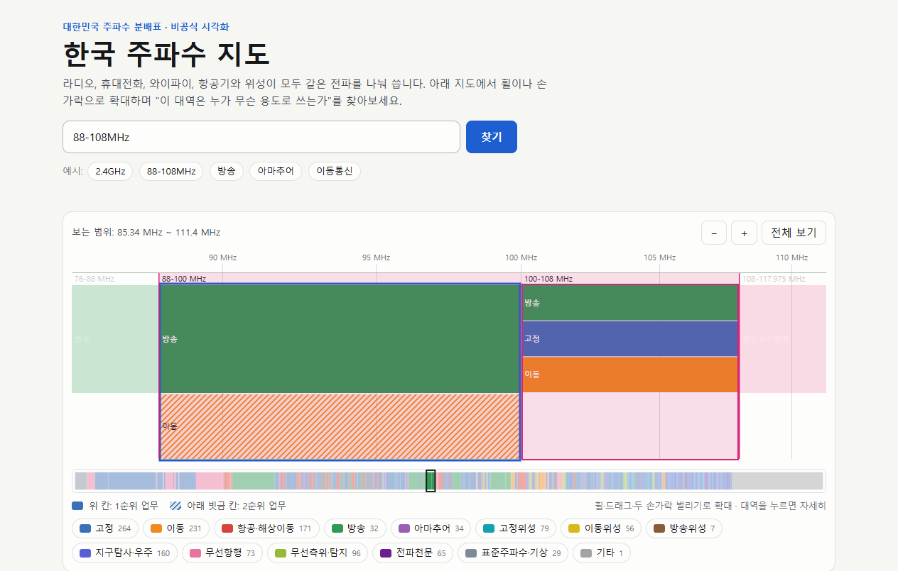

# 한국 주파수 지도

「대한민국 주파수 분배표」를 한 화면에서 확대하고 검색해 보는 페이지입니다.
8.3 kHz부터 3000 GHz까지 603개 대역이 각각 어떤 업무에 분배되어 있고 국내에서 무슨 용도로 쓰이는지, 주석 전문과 함께 볼 수 있습니다.
설치할 것도, 빌드할 것도 없습니다.

**바로 열기: https://jinhyung999.github.io/korea-spectrum-map/**



## 무엇을 할 수 있나

- **전체 스펙트럼을 한눈에** — 로그 눈금 위에 모든 대역을 업무 종류별 색으로 그립니다. 휠, 드래그, 두 손가락 벌리기, 방향키로 확대하고 이동합니다.
- **주파수로 찾기** — `2.4GHz`, `700 MHz`, `88-108MHz`, `13.56㎒`처럼 입력하면 그 대역으로 이동합니다. 단위 없이 `95.1`이라고 쓰면 MHz로 읽습니다.
- **낱말로 찾기** — `방송`, `아마추어`, `이동통신`, `K114`처럼 업무 이름, 용도, 주석 번호로 찾고 결과를 차례로 넘겨 봅니다.
- **대역 자세히 보기** — 대역을 누르면 1순위·2순위 업무, 용도, 그 대역에 걸린 주석의 전문이 나옵니다.
- **업무 종류로 걸러 보기** — 범례를 누르면 그 종류만 진하게 남습니다.
- **주소로 공유** — 검색하면 주소 끝에 `#q=2.4GHz`가 붙습니다. 그 주소를 열면 같은 화면이 나옵니다.

위 칸의 색 띠는 1순위 업무, 아래 칸의 빗금 띠는 2순위 업무입니다.
2순위 업무는 1순위 업무에 혼신을 주어서는 안 되고, 1순위 업무로부터 보호를 요구할 수도 없습니다.

## 실행

ES 모듈을 쓰기 때문에 파일을 더블클릭해서는 열리지 않고, 로컬 서버가 필요합니다.

```bash
python -m http.server 8000
# 브라우저에서 http://localhost:8000
```

## 데이터 출처

- 원문: 「대한민국 주파수 분배표」 과학기술정보통신부고시 제2024-44호, 2025년 2월 17일 시행
- 받은 곳: [국가법령정보센터 행정규칙](https://www.law.go.kr/행정규칙/대한민국주파수분배표)의 붙임 파일. `data/source/`에 hwpx와 pdf를 그대로 넣어 두었습니다.
- 고시는 저작권법 제7조에 따라 저작권 보호를 받지 않습니다.

이 페이지는 고시를 보기 쉽게 옮긴 **비공식 시각화**입니다. 효력이 있는 것은 고시 원문이고, 고시가 개정되면 이 데이터는 옛것이 됩니다. 실제 업무에 쓰기 전에는 원문을 확인하세요.

원문 표에는 국제전기통신연합(ITU) 지역별 분배(1~3란)와 대한민국 분배(4란), 용도(5란)가 나란히 있습니다. 이 저장소는 4란과 5란, 그리고 뒤쪽의 국제·국내 주석 본문만 옮겼습니다.

### 원문을 데이터로 바꾸는 방법

`scripts/build_data.py`가 hwpx 안의 표 83개를 읽어 `data/allocations.json`과 `data/footnotes.json`을 만듭니다. 파이썬 표준 라이브러리만 씁니다.

```bash
python scripts/build_data.py            # 다시 만들기
python scripts/build_data.py --report   # 업무 이름 목록까지 출력
```

원문 규칙을 그대로 따랐습니다.

| 원문 표기 | 데이터 |
|---|---|
| 업무 이름에 밑줄 없음 / 있음 | 1순위 / 2순위 (`primary`) |
| 업무 오른쪽이나 바로 아랫줄의 주석 | 그 업무의 주석 (`services[].notes`) |
| 칸 아래쪽에 따로 적힌 주석 | 대역 전체의 주석 (`notes`) |
| 용도 칸 아래쪽에 따로 적힌 주석 | 용도 줄에 붙이지 않고 따로 보관 (`usesNotes`) |

대역 사이에 빈 구간이나 겹침이 있으면 스크립트가 저장하지 않고 실패합니다.

### 원문과 다르게 한 곳

원문과 달라진 곳은 모두 스크립트에 근거와 함께 적혀 있고, `allocations.json`의 `source`에도 들어 있습니다.

- **오기 정정 1건** — 4란의 `399.9-400.5 ㎒`를 `399.9-400.05 ㎒`로 고쳤습니다. 같은 줄의 국제 분배가 399.9-400.05이고 다음 대역이 400.05에서 시작합니다. PDF판에도 같은 오기가 있습니다.
- **주석 위치 3건** — `472-479 ㎑`의 5.82·5.80B와 `13550-13570 ㎑`, `26350-27500 ㎑`의 5.150은 칸이 좁아 업무 바로 아랫줄에 적혀 있지만, 주석 본문이 대역 전체에 대한 내용이어서 대역 주석으로 두었습니다.
- **띄어쓰기** — `이동(항공이동제외)`와 `이동(항공이동 제외)`처럼 띄어쓰기만 다른 업무 이름은 가장 많이 쓰인 표기로 맞췄습니다. 칸 폭 때문에 끊긴 줄은 이었습니다.
- **넣지 않은 것** — `8.3 ㎑ 이하 미분배`는 대역 목록에 넣지 않았습니다. 주석 안에 들어 있는 표도 옮기지 않았습니다.

### 얼마나 확인했나

- 603개 대역이 8.3 kHz부터 3000 GHz까지 빈틈없이 이어지는지, 분배표에 나오는 주석 번호 452개가 모두 본문을 갖는지는 테스트로 검사합니다.
- 변환에 쓰지 않은 PDF판 22쪽(대역 174개)을 쪽 이미지로 열어 대역 범위, 업무와 순서, 밑줄(순위)을 대조했고 모두 일치했습니다. 이때 찾은 용도 칸의 주석 위치와 끊긴 줄 문제는 고쳤습니다.
- 나머지 대역은 같은 규칙으로 변환했지만 한 줄씩 눈으로 대조하지는 않았습니다. 틀린 곳을 찾으시면 이슈로 알려 주세요.

알려진 한계가 하나 있습니다. `17.7-18.1 ㎓`처럼 원문이 "고정위성(우주대지구) 5.484A (지구대우주) 5.516"으로 적은 곳은 업무 하나(`고정위성(우주대지구)(지구대우주)`)로 합쳤고, 주석이 어느 방향에 붙은 것인지는 구분하지 않습니다.

## 구조

```
index.html, css/, js/     화면 (빌드 없음, 외부 라이브러리 없음)
  js/freq.js              주파수 입력 해석과 표기
  js/scale.js             로그 축, 확대·이동 계산
  js/families.js          업무 이름 → 색 묶음 14종
  js/search.js            주파수·낱말 검색
  js/chart.js, minimap.js 캔버스 차트와 전체 보기 띠
  js/app.js               화면 연결
data/allocations.json     대역 603개
data/footnotes.json       주석 본문 1,186개
data/source/              고시 원문 (hwpx, pdf)
scripts/build_data.py     원문 → JSON
tests/                    node --test
```

```bash
npm test
```

## 라이선스

코드는 MIT 라이선스입니다. 분배표 데이터는 위 고시에서 가져왔습니다.
